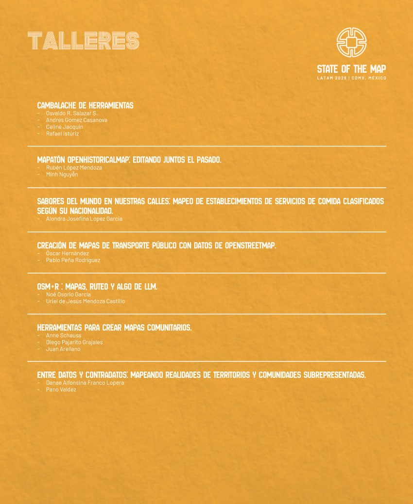

State of the Map Latam 2026
==================================

Fecha: 2026-10-14 13:00
Autor: Osvaldo
Categorías: OpenStreetMap, OSM, Talleres, CDMX, State of the Map Latam, SotM

En esta ocasión, la octava presentación del __[State of the Map Latam 2026 (SotM Latam 2026)](https://osmlatam.org/sotm/2026-es)__ se llevará a cabo en la __Ciudad de México (CDMX)__, México, entre el __27 y el 29 de octubre__.

<!-- break -->

 

 

El __State of the Map Latam (SotM Latam)__ es la conferencia regional de la __Comunidad Latinoamericana__ de __OpenStreetMap (OSM)__, cuyo objetivo es reunir a cartógrafos, desarrolladores, investigadores, académicos, gobiernos, organizaciones civiles y entusiastas de OSM para compartir experiencias, aprender, conectar y seguir colaborando en el proyecto de mapeo abierto más grande del mundo.

[Aquí](https://wiki.openstreetmap.org/wiki/ES:State_of_the_Map_Latam_2026) pueden encontrar mayor información.

### Sede

El [Antiguo Colegio de San Ildefonso](https://es.wikipedia.org/wiki/Antiguo_Colegio_de_San_Ildefonso).

### Programa

[Aquí](https://pretalx.cienciaenmexico.com/sotmlatam2026/schedule/) pueden revisar la programación de las charlas y talleres que se realizarán.

### Registro

[Aquí](https://pretix.cienciaenmexico.com/OSMLatam/sotmlatam2026/) se pueden registrar al evento.

### Taller : Cambalache de Herramientas

En este taller se invitará a compartir una demostración de la herramienta favorita, plugin, truco o función favorita en el mapeo en OSM.

Será una sesión relajada y disfrutable, no se requiere que sean un expertx de dicha herramienta para compartir lo que sabes, pero simplemente enseñar lo poco o mucho que permita a otras personas adentrarse en ella, dando así una probadita de lo que más les gusta usar para el mapeo.

 

 

__Allá nos vemos :-)__

