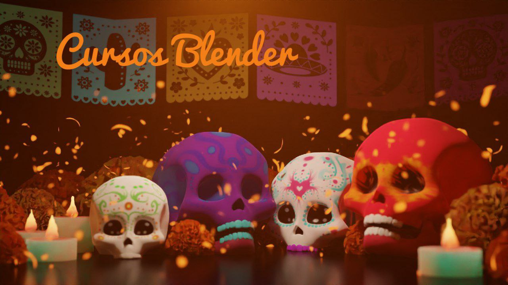

Calaverita 2026
==================================

Fecha: 2026-11-01 7:00
Autor: Osvaldo
Categorías: Calaveritas

 

 

<!-- break -->

En muchas partes del mundo se recuerda a los difuntos de una manera u otra; en México se tiene la tradición del [día de los muertos](http://es.wikipedia.org/wiki/D%C3%ADa_de_Muertos) (festividad declarada por la UNESCO [Patrimonio Cultural Inmaterial de la Humanidad](https://www.unesco.org/es/articles/el-dia-de-muertos-el-regreso-de-lo-querido)), en donde se levantan altares dedicados a determinada persona ya fallecida y la creación de calaveritas a personas (por lo general) vivas. Éstas últimas, [las calaveritas](http://es.wikipedia.org/wiki/Calavera_literaria), son versos a modo de epitafio burlesco y como modo de expresar ideas o sentimientos que en otras oportunidades sería difícil decir.

[Juan Manuel López Hernández](https://www.facebook.com/markuz.heel) me escribió una calaverita este año:

    El Lic. Osvaldo Salazar  
    Un joven bien parecido  
    La muerte se lo ha llevado  
    Para dejarlo mordido. 

    Y fue así como lo mató  
    Con una falta de ortografía  
    sabia que era perfeccionista  
    Y no lo resistiría.

    Hoy está ya con el sanpiter  
    Espero si aiga podido entrar  
    Pues siempre jue buena persona  
    Y hasi lo debían de premiar.

