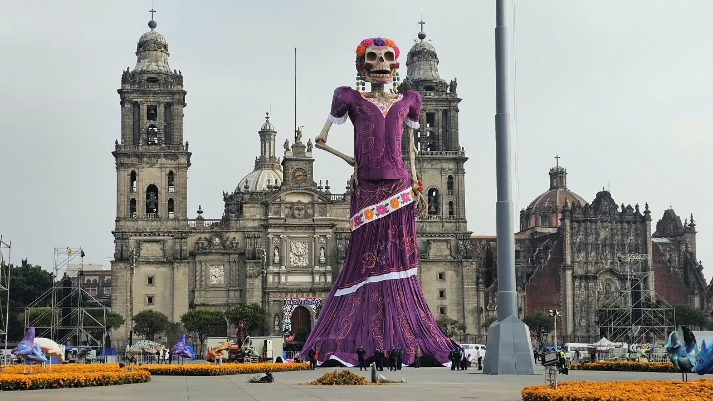

Calaverita Mapera SotM Latam 2026
==================================

Fecha: 2026-11-02 19:00
Autor: Osvaldo
Categorías: Calaveritas, OSM, OpenStreetMap

 

 

<!-- break -->

En muchas partes del mundo se recuerda a los difuntos de una manera u otra; en México se tiene la tradición del [día de los muertos](http://es.wikipedia.org/wiki/D%C3%ADa_de_Muertos) (festividad declarada por la UNESCO [Patrimonio Cultural Inmaterial de la Humanidad](https://www.unesco.org/es/articles/el-dia-de-muertos-el-regreso-de-lo-querido)), en donde se levantan altares dedicados a determinada persona ya fallecida y la creación de calaveritas a personas (por lo general) vivas. Éstas últimas, [las calaveritas](http://es.wikipedia.org/wiki/Calavera_literaria), son versos a modo de epitafio burlesco y como modo de expresar ideas o sentimientos que en otras oportunidades sería difícil decir.

Este año escribí mi primer calaverita inspirado en el [State of the Map Latam 2026 (SotM Latam 2026)](https://osmlatam.org/sotm/2026-es) realizado en CDMX este año:

    Desde cada país latinoamericano,  
    salieron mapeadoras y mapeadores,  
    con sus GPS y computadoras,  
    ¡dispuestos a trazar caminos y rincones! 

    Llegaron tod@s a Ciudad de México,  
    con entusiasmo y mucha alegría,  
    sin imaginar que la monumental Catrina  
    una gran sorpresa les tenía.

    —¡Vengan tod@s, mis querid@s!  
    —les gritó con emoción—,  
    que mi panteón está incompleto,  
    ¡le hace falta cartografía y precisión!

    —Necesito ubicar a mis residentes,  
    sus tumbas, pasillos y callejones;  
    que no se me pierdan los difuntos  
    por falta de buenas direcciones. 

    Se l@s llevó hasta el camposanto,  
    donde empezaron a trabajar,  
    un@s trazaban las avenidas,  
    otr@s los nichos fueron a etiquetar.

    Con OpenStreetMap y sus herramientas,  
    dibujaron cada rincón;  
    hasta pusieron los nombres  
    de los que descansaban en el panteón.

    La monumental Catrina estaba contenta,  
    ¡qué maravilla de comunidad!  
    —Ahora encontraré a mis difuntos  
    con mucha facilidad. 

    Pero al revisar el mapa,  
    la Flaca se puso a temblar:  
    ¡habían mapeado tantas tumbas  
    que hasta a ella pudieron localizar!

    La Catrina soltó una carcajada,  
    y se puso a festejar:  
    —¡Qué bueno que llegaron tod@s,  
    ya nadie se me va a extraviar!

    Y así terminó el State of the Map Latam,  
    con gran fiesta y emoción;  
    Latinoamérica había dejado  
    bien mapeado hasta el panteón. 

    Moraleja de esta historia,  
    que no se debe olvidar:  
    ¡hasta la Muerte necesita un mapa  
    para no andar dando vueltas sin llegar!

